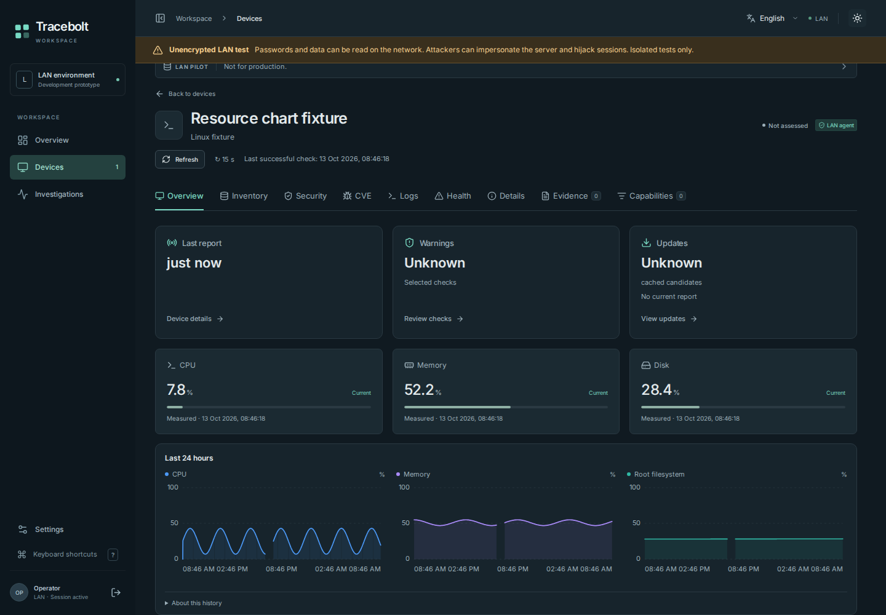
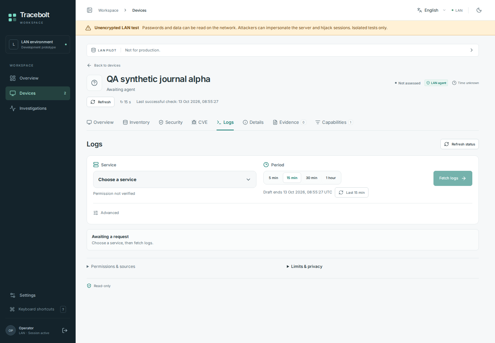
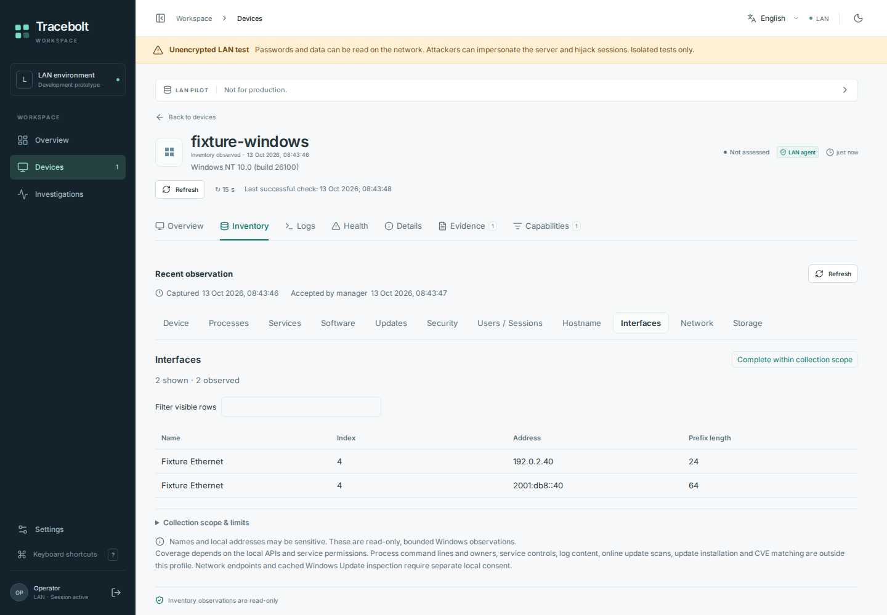
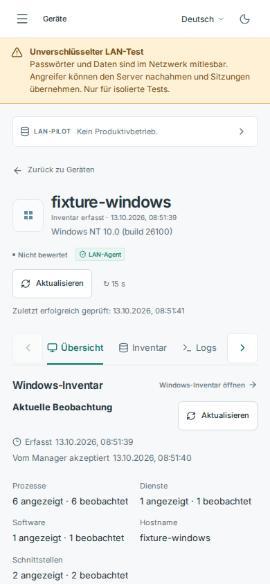

# Tracebolt

**Inventory, logs and diagnostics in one self-hosted dashboard.**

A Go manager and native endpoint agents, with an English/German web interface,
light and dark themes, and mobile layouts. Tracebolt is a development pilot;
source features and tested release coverage are listed separately below.

[Get started](#get-started) · [Screenshots](#screenshots) · [Guides](docs/README.md)



*Actual dashboard capture with invented test data. [Capture details](docs/screenshots/2026-10-13-current-ui/README.md).*

## Current status

| Component | Available now | Main limit |
| --- | --- | --- |
| Manager | Linux, native or Docker; authenticated dashboard and agent ingress | Built and configured separately from endpoint downloads |
| Linux | [v0.1.0-rc.3](https://github.com/storminator89/Tracebolt/releases/tag/v0.1.0-rc.3), amd64 Read admin installation | Ubuntu 24.04 / Debian 13, systemd, cgroup v2, kernel 6.5+; [ARM64/Pi](docs/linux-arm64-support.md) remains a source/testing path |
| Windows | [v0.1.0-windows-preview.3](https://github.com/storminator89/Tracebolt/releases/tag/v0.1.0-windows-preview.3), unsigned x64 Setup with 21-scope Read admin review | Native acceptance covers three hosted Server 2025 packaged-Setup cases; Windows 10/11 and complete provider coverage are unverified |
| macOS | Limited local read-only collector | LAN enrollment and an installed service are in development, not released |

### In the current source

- **Inventory and resources:** device search, CPU/RAM/disk history, processes,
  services, software, network and storage views, with observation times and
  explicit missing, stale or partial data.
- **Linux inspection:** selected service logs, cached APT candidates and bounded
  Debian/Ubuntu CVE warnings.
- **Windows inspection:** hardware, sessions, security-provider observations,
  build/update history, Application/System event headers and separately granted
  historical-message reads or cached Windows Update inspection.
- **Fleet monitoring:** groups, selected health policies, an incident inbox,
  maintenance windows and separately approved notifications.
- **Optional workflows:** scoped AI diagnostics, selected service control,
  software delivery and update jobs. These require their own setup and approval;
  Windows MSI/WUA/service-action native acceptance remains pending.

Collection is limited by each endpoint's explicit grants and accessible sources.
Read admin does not enable every optional feature. See the
[technical guides](docs/README.md) for individual scope contracts.

## Get started

### Try the dashboard locally

From the repository root, with Go **1.27.1**, Node.js **24**, npm and `make`:

```sh
make web
make build
./bin/manager
```

Open **http://127.0.0.1:8787**. This loopback-only demo uses synthetic devices
and a limited read-only sample of the local machine. State is saved in
`.local/state.db`; Ctrl+C stops it. [Demo troubleshooting](docs/troubleshooting.md#local-demo).

### Connect real devices

1. **Manager:** follow the [installation guide](docs/installation.md) for a
   Linux/Docker LAN manager with approved protected TLS material and operator
   authentication. There is no zero-configuration production installer.
2. **Linux:** configure guided enrollment, then use **Add device** and its
   [verified rc.3 installation command](docs/dashboard-verified-download.md).
   Review the local scope and compare/approve the device fingerprint.
3. **Windows:** download [preview.3](https://github.com/storminator89/Tracebolt/releases/tag/v0.1.0-windows-preview.3)
   and follow its attached [installation guide](https://github.com/storminator89/Tracebolt/releases/download/v0.1.0-windows-preview.3/windows-prerelease-install.md).
   Build the manager/frontend from the guide's exact source pin. Verify the
   release hashes, review Setup's unchecked permissions and keep OS protections intact.
4. Confirm authenticated login, the endpoint service and fresh accepted reports
   in the dashboard. A running process does not prove successful collection.

**Windows manager prerequisite:** stock Compose starts manual-v1 only. Windows
enrollment needs `windowsInventoryEnabled: true`, approved guided-enrollment
issuer material and an explicit `--enrollment-config` alongside `--lan-config`.
See [enrollment configuration](docs/enrollment-v2/runtime-config.md) and the
[fresh renewal policy](docs/automatic-certificate-renewal.md). The pinned manager's
invitation help is outdated; the release guide and Setup's 21-scope review govern
the installation. Enter invitations only at the hidden local prompt.

## Important limits

- **Windows preview:** real Linux-manager/shared-dashboard interoperability,
  native restart/reboot, renewal cutover and optional MSI/WUA/service actions
  remain unverified. Setup is unsigned. Service removal retains files, keys and
  state; it does not revoke manager trust.
- **Data coverage:** cached updates are not a patch-compliance assessment;
  security observations do not prove protection. Software inventory is not a
  complete list of every user's or portable application. Process CPU/RAM is a
  separate bounded sample.
- **Permissions:** the main observer stays unprivileged; helpers, host changes,
  external delivery and AI use need separate approval. There is no arbitrary
  remote shell or integrated remote desktop.
- **Deployment:** HTTPS is the default. HTTP is only for explicitly approved
  isolated tests and exposes credentials/content. Production hardening and
  verified reboot persistence remain open.

## Screenshots

| Linux log workspace | Windows inventory | Mobile overview, German |
| --- | --- | --- |
| [](docs/screenshots/2026-10-13-current-ui/log-workspace.png) | [](docs/screenshots/2026-10-13-current-ui/windows-inventory.png) | [](docs/screenshots/2026-10-13-current-ui/windows-mobile-de.png) |

*Unmodified browser captures of the current preview.3 source UI, using invented
test data. Click to enlarge. They show the interface, not native installation or
provider acceptance. [Source and capture details](docs/screenshots/2026-10-13-current-ui/README.md).*

## Development

Run `make test`, `make build` and the [frontend checks](web/README.md#checks).
Follow [AGENTS.md](AGENTS.md) and the [technical guides](docs/README.md).

## License

[Apache License 2.0](LICENSE). Dependencies retain their own
[licenses and notices](docs/dependencies/edwards25519.md).
