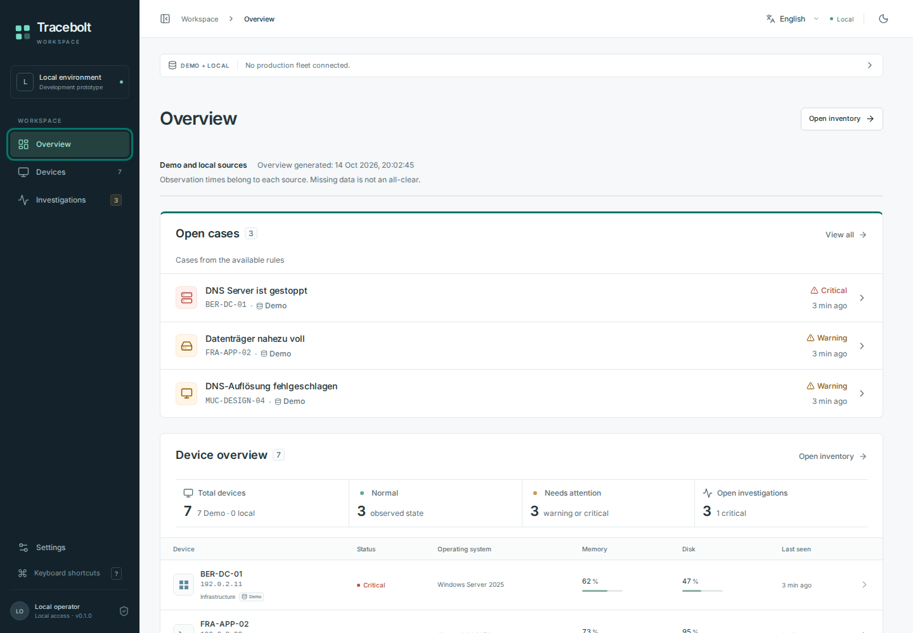
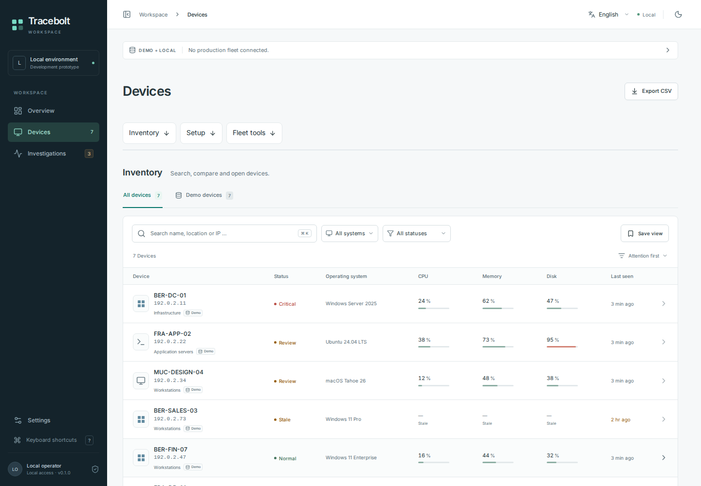
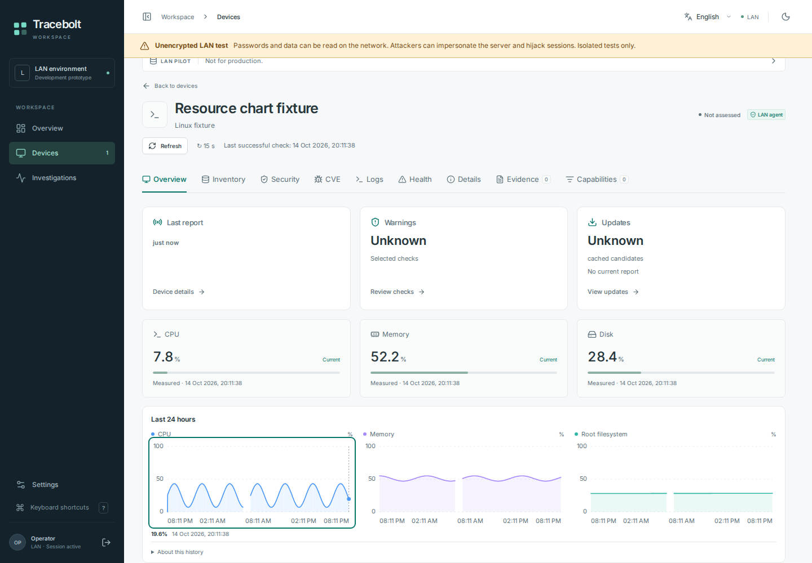
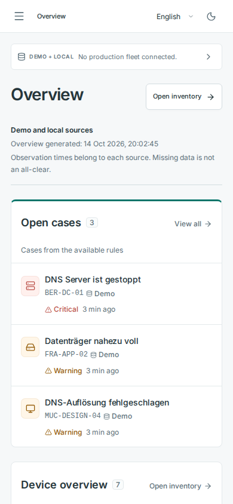

# Tracebolt

**Inventory, logs and diagnostics in one self-hosted dashboard.**

A Go manager and native endpoint agents, with an English/German web interface,
light and dark themes, and mobile layouts. Tracebolt is a development pilot;
source features and tested release coverage are listed separately below.

**Status reviewed: 6 November 2026.** Published previews are controlled-test
packages, not a production-ready or unattended RMM release.

[What's new](#new-in-main) · [Get started](#get-started) · [Screenshots](#screenshots) · [Releases](https://github.com/storminator89/Tracebolt/releases) · [Guides](docs/README.md)



*Actual redesigned dashboard with invented test data. [Capture details](docs/screenshots/2026-10-14-redesign/README.md).*

## Current status

| Component | Available now | Main limit |
| --- | --- | --- |
| Manager | Linux, native or Docker; authenticated dashboard and agent ingress; matching Linux amd64 binary/frontend in Rust integrated test releases | TLS, protected issuer material and operator authentication must still be provisioned; no zero-configuration deployment |
| Linux | [v0.1.0-rc.3](https://github.com/storminator89/Tracebolt/releases/tag/v0.1.0-rc.3), amd64 Read admin installation | Ubuntu 24.04 / Debian 13, systemd, cgroup v2, kernel 6.5+; [ARM64/Pi](docs/linux-arm64-support.md) remains a source/testing path |
| Windows — Go Read admin | [v0.1.0-windows-preview.3](https://github.com/storminator89/Tracebolt/releases/tag/v0.1.0-windows-preview.3), unsigned x64 Setup with 21-scope Read admin review | Native acceptance covers three hosted Server 2025 packaged-Setup cases; Windows 10/11 and complete provider coverage are unverified |
| Windows — Rust Basic | Published [integrated test candidates](docs/integrated-test-candidate.md): unsigned x64 ZIP/EXE plus same-source Linux manager/frontend | CPU, physical RAM, system-drive capacity and uptime only; Server 2025 protocol-fixture evidence, not real Windows→Linux-manager→browser acceptance |
| macOS | [v0.1.0-macos-preview.1](https://github.com/storminator89/Tracebolt/releases/tag/v0.1.0-macos-preview.1), Apple Silicon and Intel service-test packages, preparation helper and runbook | Unsigned and not notarized; native enrollment, installation, launchd operation and reboot persistence are not yet accepted |

Go Read admin and Rust Basic are **different endpoint profiles**, not successive
versions of one installer. Select the manager/frontend and endpoint together from
the chosen release's manifest and verify its hashes. Do not mix arbitrary main
builds, older previews or packages from different integrated candidates. Publication
and a passing disposable fixture do not establish full native acceptance.

### New in main

The following summarizes merged source through
[`1d60309`](https://github.com/storminator89/Tracebolt/commit/1d60309ca407a72245d429cb069bb523a5d47448)
(6 November 2026), including the saved Windows update-job filters in
[#267](https://github.com/storminator89/Tracebolt/pull/267). Open drafts and planned
features are not counted. Check each chosen release's source pin: a main feature
is not automatically present in an older package or an installed manager.

- **One investigation workspace:** [Investigations](docs/incident-work-queue.md)
  brings Linux Health and Windows incidents together, with page-local search and
  filters, original-time episode timelines and comparison of two to four exact
  episodes. Each source keeps its own counts, paging and lifecycle. Seen does not
  mean recovered; overlapping times do not prove a common cause.
- **Readiness you can inspect:** the device [Capabilities summary](docs/device-readiness.md)
  separates report age, certificate validity, reported version and source states.
  The [Manager status panel](docs/manager-status-panel.md) shows bounded core checks
  and loaded certificate dates on demand. Neither gives a whole-fleet health score
  or substitutes for native/deployment acceptance.
- **Patch and job review:** a [Patch evidence tab](docs/patch-evidence-overview.md)
  separates Linux cached APT and Windows cached-update/history evidence. Windows
  [retained update events](docs/windows-update-history-review.md) have local text,
  outcome and date filters. Separately, [saved update jobs](docs/windows-selected-update-jobs.md#local-review-of-saved-jobs)
  can be filtered by ID/revision, installation/download and saved state/result.
  These bounded histories do not prove current installation or patch compliance.
- **More useful evidence views:** compare intervals in [resource history](docs/resource-history.md)
  and [Linux network observations](docs/linux-network-intervals.md), review and group
  messages on a [loaded journal page](docs/journal-page-triage.md), and inspect
  [saved Linux service-action receipts](docs/linux-service-action-history.md) with
  the required named capability. Original times, gaps and uncertain outcomes stay
  visible; reviewing evidence does not retry an action.
- **Opt-in Linux monitoring:** [exact-name process watches](docs/linux-process-watches.md)
  and a [selected non-root mount-capacity watch](docs/linux-mount-capacity-watch.md)
  use already-consented complete observations and retain bounded local incidents.
  Their setup is explicit. Missing or stale evidence stays unknown, and stopping
  monitoring is distinct from observed recovery.
- **Windows process presence:** [saved exact-name watches](docs/windows-process-presence-watches.md)
  show presence in an admitted complete process snapshot. This is a live snapshot
  view without alerts or incident history, not proof that an application is healthy.
  Complete-process and network searches also explain unapplied filters and offer
  local reset controls.
- **Application-check history and incidents:** existing manager-side HTTP/HTTPS,
  DNS and TCP checks now offer [recent observations](docs/application-check-history.md)
  and separately enabled [local incidents](docs/application-local-incidents.md).
  Investigations includes their independent read-only history. History reads start
  no probe; these checks do not establish endpoint health or an uptime percentage.
- **One-time maintenance planning:** [Linux Health](docs/linux-health-maintenance-schedule.md)
  and [Windows notifications](docs/windows-scheduled-maintenance.md) have reviewed
  fixed UTC windows, cancellation and early end. Linux suppresses new Health
  incident openings and associated alarm admission; Windows keeps incidents and
  evidence while suppressing separately approved notifications. There is no
  recurring schedule or host action. Alarm settings also explain retained failed,
  uncertain and dropped delivery counts without resending messages.

### Platform and administration progress

- **Rust onboarding and diagnostics:** automatic registration still requires
  local scope acknowledgement and dashboard identity approval. The
  [installer preflight](docs/rust-installer-preflight.md) now checks package hashes,
  executable format, protected paths and supplied inputs before staging, alongside
  the [manager compatibility check](docs/rust-manager-compatibility.md).
  [Diagnostics](docs/rust-agent-health.md) include bounded startup, DNS, TLS,
  connectivity and best-effort Windows Event Log reporting, plus read-only status
  and support output. Hashes do not authenticate an unsigned publisher; complete
  native acceptance remains open. The [scope comparison](docs/windows-agent-parity.md)
  makes clear that Rust Basic still lacks broader Go Read admin inventory.
- **Manager preparation and recovery:** the create-only [configuration helper and
  doctor](docs/manager-initialization.md), bounded readiness/certificate evidence,
  [writer ownership and HTTP drain](docs/manager-writer-exclusion.md), and explicit
  [restore quarantine](docs/restore-quarantine.md) improve setup and failure handling.
  They do not provision trust, prove database integrity or provide accepted full
  backup/restore recovery.
- **Accounts and enrollment:** [named-account boundaries](docs/named-administration-matrix.md)
  now cover scoped session management and explicit read-only customer access.
  Full named administration remains incomplete; [customer records](docs/customer-records.md)
  are organizational, not tenant isolation. The [enrollment capacity summary](docs/enrollment-v2/runtime-config.md#record-capacity-visibility-tb-18-partial)
  shows configured limits, retained records and remaining slots. Ended records
  still consume capacity; no larger-fleet acceptance is implied.

See the [lean roadmap](docs/lean-roadmap.md) for the development direction and the
linked feature guides for their remaining acceptance gates. Implemented source
and tested release coverage remain separate.

### In the current source

- **Redesigned workspace:** an operations overview for open cases, device
  observations and recent changes; **Devices → Inventory / Setup / Fleet tools**
  separates daily browsing from enrollment and fleet workflows. Search, filters,
  sorting and a saved view keep inventory easy to navigate.
- **Inventory and resources:** device search, CPU/RAM/disk history, processes,
  services, software, network and storage views, with observation times and
  explicit missing, stale or partial data.
- **Linux inspection:** selected service logs, cached APT candidates and bounded
  Debian/Ubuntu CVE warnings.
- **Windows inspection:** hardware, sessions, security-provider observations,
  build/update history, Application/System event headers and separately granted
  historical-message reads or cached Windows Update inspection.
- **macOS inspection:** separate basic read-only and fresh read-inventory TLS
  profiles. The inventory profile reports hardware context, Installer receipt
  IDs, caller-visible processes and passive interface addresses. Receipt IDs are
  not a complete application inventory; native acceptance remains pending.
- **Fleet monitoring:** groups, selected health policies, an incident inbox,
  maintenance windows and separately approved notifications.
- **Optional workflows:** scoped AI diagnostics, selected service control,
  software delivery and update jobs. These require their own setup and approval;
  Windows MSI/WUA/service-action native acceptance remains pending.

Collection is limited by each endpoint's explicit grants and accessible sources.
Read admin does not enable every optional feature. See the
[technical guides](docs/README.md) for individual scope contracts.

## Get started

### Try the dashboard locally

From the repository root, with Go **1.27.1**, Node.js **24**, npm and `make`:

```sh
make web
make build
./bin/manager
```

Open **http://127.0.0.1:8787**. This loopback-only demo uses synthetic devices
and a limited read-only sample of the local machine. State is saved in
`.local/state.db`; Ctrl+C stops it. [Demo troubleshooting](docs/troubleshooting.md#local-demo).

For a presentation with **only synthetic examples**, run `./bin/manager --demo-only`
with a separate fresh `--db` path. This disables local collection and developer
telemetry. On Windows, the [demo launcher](docs/local-demo.md) checks the pinned
toolchain, builds the current source and opens a fresh loopback-only session:

```powershell
.\deploy\demo\Start-Demo.ps1
```

### Connect real devices

1. **Manager:** follow the [installation guide](docs/installation.md) for a
   Linux/Docker LAN manager with approved protected TLS material and operator
   authentication. There is no zero-configuration production installer.
2. **Linux:** configure guided enrollment, then use **Add device** and its
   [verified rc.3 installation command](docs/dashboard-verified-download.md).
   Review the local scope and compare/approve the device fingerprint.
3. **Windows — choose one profile:** for broader Go Read admin, download [preview.3](https://github.com/storminator89/Tracebolt/releases/tag/v0.1.0-windows-preview.3)
   and follow its attached [installation guide](https://github.com/storminator89/Tracebolt/releases/download/v0.1.0-windows-preview.3/windows-prerelease-install.md).
   Build the manager/frontend from the guide's exact source pin. Verify the
   release hashes, review Setup's unchecked permissions and keep OS protections intact.
   For the smaller **Rust Basic** collector, use its
   [integrated candidate guide](docs/integrated-test-candidate.md) and
   [package instructions](rust/windows-agent/README.md) instead. Take
   `windows-rust.zip` and `manager-linux-amd64.tar.gz` from the **same** immutable
   candidate; configure the manager separately. Default onboarding needs no
   invitation token, but still needs local scope acknowledgement and dashboard
   identity approval. Do not reuse a Go Read admin identity or retained Rust state.
4. **macOS test package:** download the archive and matching preparation helper
   for Apple Silicon (`arm64`) or Intel (`amd64`) from [preview.1](https://github.com/storminator89/Tracebolt/releases/tag/v0.1.0-macos-preview.1).
   Start with the [release guide](https://github.com/storminator89/Tracebolt/releases/download/v0.1.0-macos-preview.1/macos-prerelease.md)
   and the archive's `TESTING.md`. Verify the helper/archive hashes against an
   independently trusted source before execution. The matching manager source
   is pinned by `release-manifest.json`; enable only the chosen TLS enrollment
   domain. Account preparation, enrollment and service installation each need
   local review and approval on a disposable test Mac.
5. Confirm authenticated login, the endpoint service and fresh accepted reports
   in the dashboard. A running process does not prove successful collection.

**Windows manager prerequisite:** stock Compose starts manual-v1 only. Windows
enrollment needs `windowsInventoryEnabled: true`, approved guided-enrollment
issuer material and an explicit `--enrollment-config` alongside `--lan-config`.
See [enrollment configuration](docs/enrollment-v2/runtime-config.md) and the
[fresh renewal policy](docs/automatic-certificate-renewal.md). The pinned manager's
invitation help is outdated for Go preview.3; its release guide and Setup's
21-scope review govern that installation. Rust Basic requires the matching
TLS **non-renewal** Windows domain and its own compatibility contract; it is not
21-scope collection or a distinct basic-only server authorization domain. Enter
invitation secrets only at the hidden local prompt when using invitation mode.

## Important limits

- **Windows Go preview:** real Linux-manager/shared-dashboard interoperability,
  native restart/reboot, renewal cutover and optional MSI/WUA/service actions
  remain unverified. Setup is unsigned. Service removal retains files, keys and
  state; it does not revoke manager trust.
- **Rust Basic test candidate:** the hosted Server 2025 service fixture covers
  installation, onboarding, reports, service restart and removal, not a real
  Linux-manager/shared-dashboard workflow. Windows 10/11, actual OS reboot,
  signed packaging, identity-preserving upgrade/repair and full purge remain open.
  Automatic certificate renewal is not implemented; credentials are issuer-bound
  and typically valid for at most seven days. This is not unattended fleet support.
  Removal retains identity/state and does not revoke manager trust; never reset
  counters or delete used state to repair an installation.
- **macOS preview:** public downloads are service-test candidates, not a
  production-ready installer. Keep Gatekeeper and other OS protections intact;
  stop if local policy blocks the unsigned package. Basic and inventory grants
  are separate and never expand automatically. [Release boundaries](docs/macos-prerelease.md).
- **Data coverage:** cached updates are not a patch-compliance assessment;
  security observations do not prove protection. Software inventory is not a
  complete list of every user's or portable application. Process CPU/RAM is a
  separate bounded sample.
- **Permissions:** the main observer stays unprivileged; helpers, host changes,
  external delivery and AI use need separate approval. There is no arbitrary
  remote shell or integrated remote desktop.
- **Deployment:** HTTPS is the default. HTTP is only for explicitly approved
  isolated tests and exposes credentials/content. Production hardening and
  verified reboot persistence remain open. Recent merged work has known failing
  CI checks; full source/browser acceptance is not established. Mandatory
  release-gate work remains tracked in [TB-25](https://github.com/storminator89/Tracebolt/issues/152). A published
  unsigned test candidate is not an all-green production-release claim.

## Screenshots

| Device inventory | Device overview | Mobile operations |
| --- | --- | --- |
| [](docs/screenshots/2026-10-14-redesign/devices-desktop.png) | [](docs/screenshots/2026-10-14-redesign/device-overview.png) | [](docs/screenshots/2026-10-14-redesign/overview-mobile.png) |

*Unmodified browser captures of the merged redesign on 14 October 2026, using
invented test data. Click to enlarge. They predate the newer features summarized
above and may differ from current main or a pinned release. They do not prove
native installation, collection or provider coverage. [Source, capture details and image hashes](docs/screenshots/2026-10-14-redesign/README.md).*

## Development

Run `make test`, `make build` and the [frontend checks](web/README.md#checks).
Follow [AGENTS.md](AGENTS.md) and the [technical guides](docs/README.md).

## License

[Apache License 2.0](LICENSE). Dependencies retain their own
[licenses and notices](docs/dependencies/edwards25519.md).
