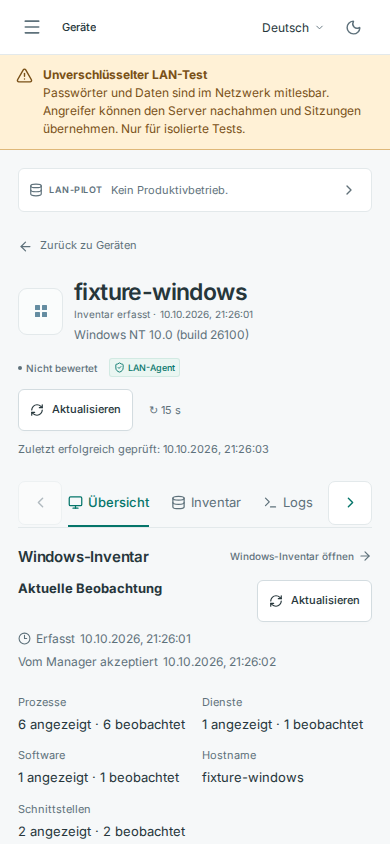

# Tracebolt

**Inventory, logs and diagnostics in one self-hosted dashboard.**

Tracebolt combines a Go manager, native endpoint agents and an English/German
web interface with light and dark themes. It is under active development.
This page describes the current source; downloadable prereleases cover less.

[Get started](#get-started) · [Guides](docs/README.md) · [Windows status](docs/windows-status.md) · [Next steps](#what-is-next)


*Dashboard capture using invented test data. [Capture details](docs/screenshots/2026-10-09-main-ui/README.md).*

## What works in the current source

- **Device overview:** hostname/IP search, resource history, source timestamps
  and explicit missing, stale or partial data.
- **Linux inspection:** visible processes and mounts, dpkg software, services,
  connections, selected service logs, cached APT candidates and bounded
  Debian/Ubuntu CVE warnings.
- **Windows inspection:** complete caller-visible process snapshots, a separate
  bounded process CPU/RAM sample, volumes, numeric network endpoints,
  complete caller-visible Win32 services and machine software registrations,
  adapter configuration, build/update history, Defender/Firewall posture,
  client Security Center antivirus registration/status, TPM presence/version,
  sessions/join context, hardware/firmware/power details, drive-letter mapping
  and physical-disk provider status. Separately consented
  [CPU/memory context](docs/windows-resource-context.md) adds source-labeled
  processor counts, installed/usable RAM, commit capacity and aggregate pagefile use.
  Independent [aggregate disk I/O](docs/windows-storage-io.md) adds local PerfDisk
  throughput, operations, latency, queue lengths and sample timing.
- **Windows logs and updates:** Application/System event headers, separately
  approved older-event searches and selected message reads, and offline cached
  Windows Update inspection.
- **Selected Windows updates (source):** [explicit endpoint setup](docs/windows-selected-update-setup.md),
  a manual fleet worklist, per-device cached-update review, one-time approval
  and saved executor outcomes. Native setup and update execution still need acceptance.
- **Selected-account software:** an explicitly consented foreground capture of
  that Windows user's HKCU and Store registrations, with source filters and paging.
- **Fleet groups:** organize devices and review one-time disk/CPU/RAM alert
  settings for selected Windows members, with individual outcomes.
- **Windows incidents and maintenance:** a [fleet incident inbox](docs/windows-incident-inbox.md),
  seen acknowledgements and [planned maintenance](docs/windows-maintenance.md).
  Planning labels do not suppress alerts.
- **Optional monitoring:** platform-specific health checks, manager-side
  application checks, webhook alarms and separately approved AI diagnostics.

Collection depends on the endpoint's explicitly approved scope and accessible
sources. Windows software covers machine HKLM registrations plus the separately
captured account; it does not discover every user's or portable application.
Complete process inventory does not expand the separate 128-row CPU/RAM sample.
Cached updates do not prove patch compliance, and security observations do not
prove that a device is protected.
[Windows scope and limitations](docs/windows-status.md).

## Get started

### Try the local dashboard

From the repository root, with Go **1.27.1**, Node.js **24**, npm and `make`:

```sh
make web
make build
./bin/manager
```

Open **http://127.0.0.1:8787**. This loopback-only demo shows seven synthetic
devices and a limited read-only sample of the machine running it. State is saved
in `.local/state.db`; Ctrl+C stops it. It does not connect remote devices or
install a service. [Demo troubleshooting](docs/troubleshooting.md#local-demo).

### Connect real devices

1. Prepare an authenticated Linux or Docker LAN manager using the
   [installation guide](docs/installation.md). HTTPS is the default.
2. **Linux:** use **Add device** and the
   [verified installation command](docs/dashboard-verified-download.md). Review
   the read-admin scope locally, enter the invitation at the hidden prompt, then
   compare and approve the device fingerprint in the dashboard.
3. **Windows development:** the current fresh Setup offers
   [Read admin](docs/windows-read-admin-setup.md), with grouped scope details and
   unchecked consent. It requires matching source-built manager/endpoint
   artifacts. Native acceptance and a release of this profile are still pending.
4. Check the first accepted report, observation time and actual source coverage.
   Choosing a profile does not prove that every provider returned data.

The published Linux endpoint is
[v0.1.0-rc.3](https://github.com/storminator89/Tracebolt/releases/tag/v0.1.0-rc.3).
The separate unsigned x64
[Windows preview.1](https://github.com/storminator89/Tracebolt/releases/tag/v0.1.0-windows-preview.1)
contains the older five-scope read-only setup, not the current Read admin profile.
Use its [installation guide](docs/windows-prerelease-install.md) only for those
published bytes. Manager deployment is separate from both endpoint downloads.

## Giving this repository to an agent

Include the target computer and use this short handoff:

> Read AGENTS.md and docs/installation.md. Inspect the target OS/architecture,
> checkout and existing configuration. Use the shortest supported Linux/Docker
> manager setup, then the dashboard's verified Linux enrollment command. Ask for
> approval before credential/trust, network or service changes; never put secrets
> in chat. Check login, the endpoint service and fresh real device data. Report
> what works and what is still blocked. For Windows, distinguish the published
> preview from the current source-only Read admin setup.

The [installation-agent fast path](docs/installation.md#fast-path-for-installation-agents)
points directly to the Compose commands, required configuration and smoke checks.
There is no zero-configuration production installer; the local demo above is the
quickest way to look at the dashboard.

## Platform and safety limits

- **Manager:** Linux, native or Docker.
- **Linux release:** amd64, Ubuntu 24.04 or Debian 13, systemd, cgroup v2 and
  kernel 6.5+. [ARM64/Pi](docs/linux-arm64-support.md) remains a source/testing path.
- **Windows:** current development targets a fresh x64 installation. The old
  preview has a limited hosted Server 2025 acceptance result; Windows 10/11,
  current-source installed-service behavior and reboot remain unverified.
- **macOS:** a limited standalone collector; no supported LAN installation path.

The main agent stays unprivileged. Helpers, service control, selected package
updates, external delivery and AI use have separate permissions. Read admin does
not grant them all. There is no arbitrary remote shell or integrated remote
desktop. HTTP is only for explicitly approved isolated tests: it exposes
credentials and content on the network. Production hardening remains open.

## What is next

Build on the inventory with useful job results, fleet monitoring policies and
carefully scoped software/update management. Close the remaining Admin data gaps
alongside that work. Fresh native installation and the real manager-to-endpoint
flow must be validated before a new Windows release.
There is no existing-user migration rollout. Remote desktop is deferred.

[Windows priorities](docs/windows-admin-roadmap.md) · [Linux priorities](docs/roadmap.md)

## A look at the dashboard

| Linux service logs | Cached Windows Updates | Mobile overview, German |
| --- | --- | --- |
| [](docs/screenshots/2026-10-09-main-ui/log-workspace.png) | [](docs/screenshots/2026-10-10-windows-parity/windows-cached-updates.png) | [](docs/screenshots/2026-10-10-windows-parity/windows-mobile-de.png) |

*Genuine dashboard captures with invented test data; click to enlarge. Windows
examples show unreleased source previews. These illustrate the recorded source,
not native acceptance. [Linux capture details](docs/screenshots/2026-10-09-main-ui/README.md)
and [Windows capture details](docs/screenshots/2026-10-10-windows-parity/README.md).*

## Development

Run `make test`, `make build` and the [frontend checks](web/README.md#checks).
Follow [repository constraints](AGENTS.md) and the [technical guides](docs/README.md).
CI, fixtures and screenshots describe their exercised scope; they do not replace
native host acceptance.

## License

[Apache License 2.0](LICENSE). Dependencies retain their own
[licenses and notices](docs/dependencies/edwards25519.md).
