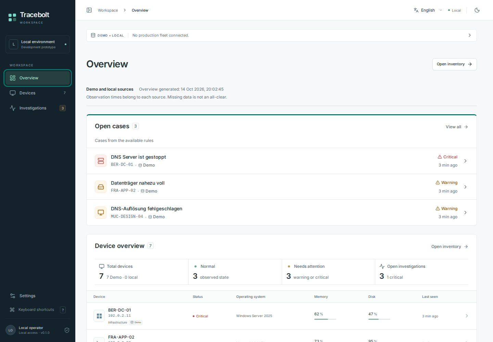
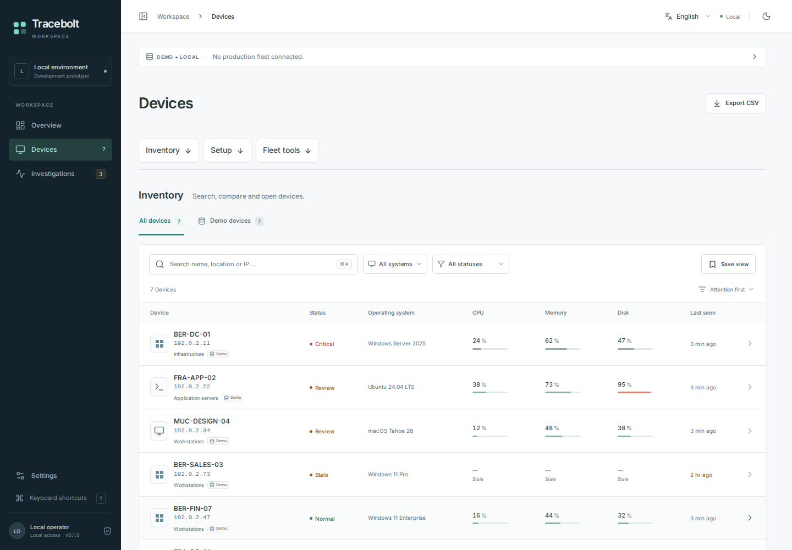
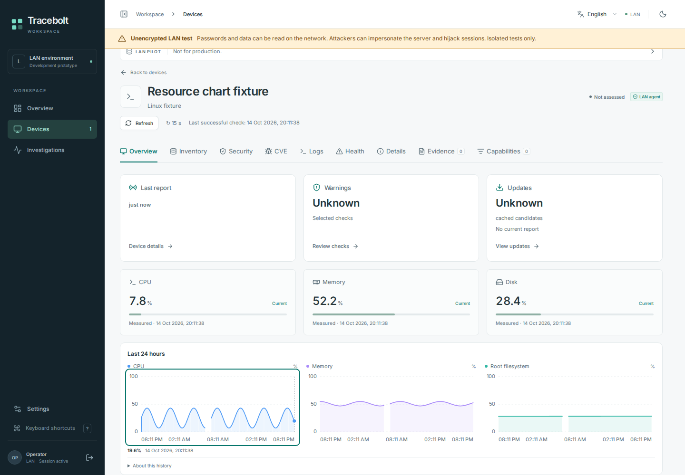
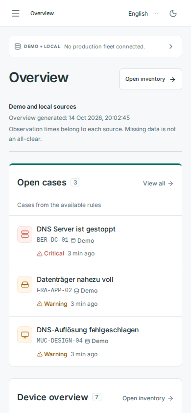

# Tracebolt

**Inventory, logs and diagnostics in one self-hosted dashboard.**

A Go manager and native endpoint agents, with an English/German web interface,
light and dark themes, and mobile layouts. Tracebolt is a development pilot;
source features and tested release coverage are listed separately below.

[Get started](#get-started) · [Screenshots](#screenshots) · [Releases](https://github.com/storminator89/Tracebolt/releases) · [Guides](docs/README.md)



*Actual redesigned dashboard with invented test data. [Capture details](docs/screenshots/2026-10-14-redesign/README.md).*

## Current status

| Component | Available now | Main limit |
| --- | --- | --- |
| Manager | Linux, native or Docker; authenticated dashboard and agent ingress | Built and configured separately from endpoint downloads |
| Linux | [v0.1.0-rc.3](https://github.com/storminator89/Tracebolt/releases/tag/v0.1.0-rc.3), amd64 Read admin installation | Ubuntu 24.04 / Debian 13, systemd, cgroup v2, kernel 6.5+; [ARM64/Pi](docs/linux-arm64-support.md) remains a source/testing path |
| Windows | [v0.1.0-windows-preview.3](https://github.com/storminator89/Tracebolt/releases/tag/v0.1.0-windows-preview.3), unsigned x64 Setup with 21-scope Read admin review | Native acceptance covers three hosted Server 2025 packaged-Setup cases; Windows 10/11 and complete provider coverage are unverified |
| macOS | [v0.1.0-macos-preview.1](https://github.com/storminator89/Tracebolt/releases/tag/v0.1.0-macos-preview.1), Apple Silicon and Intel service-test packages, preparation helper and runbook | Unsigned and not notarized; native enrollment, installation, launchd operation and reboot persistence are not yet accepted |

### In the current source

- **Rust Windows basic agent:** a separate source candidate for CPU/RAM/system-drive
  telemetry, mutual TLS reporting and a simple Windows service package. See the
  [Rust agent guide](rust/windows-agent/README.md) for build/install steps,
  fresh-identity prerequisites and pending native acceptance. It does not replace
  the Go Read admin agent's full inventory or administration features.

- **Redesigned workspace:** an operations overview for open cases, device
  observations and recent changes; **Devices → Inventory / Setup / Fleet tools**
  separates daily browsing from enrollment and fleet workflows. Search, filters,
  sorting and a saved view keep inventory easy to navigate.
- **Inventory and resources:** device search, CPU/RAM/disk history, processes,
  services, software, network and storage views, with observation times and
  explicit missing, stale or partial data.
- **Linux inspection:** selected service logs, cached APT candidates and bounded
  Debian/Ubuntu CVE warnings.
- **Windows inspection:** hardware, sessions, security-provider observations,
  build/update history, Application/System event headers and separately granted
  historical-message reads or cached Windows Update inspection.
- **macOS inspection:** separate basic read-only and fresh read-inventory TLS
  profiles. The inventory profile reports hardware context, Installer receipt
  IDs, caller-visible processes and passive interface addresses. Receipt IDs are
  not a complete application inventory; native acceptance remains pending.
- **Fleet monitoring:** groups, selected health policies, an incident inbox,
  maintenance windows and separately approved notifications.
- **Optional workflows:** scoped AI diagnostics, selected service control,
  software delivery and update jobs. These require their own setup and approval;
  Windows MSI/WUA/service-action native acceptance remains pending.

Collection is limited by each endpoint's explicit grants and accessible sources.
Read admin does not enable every optional feature. See the
[technical guides](docs/README.md) for individual scope contracts.

## Get started

### Try the dashboard locally

From the repository root, with Go **1.27.1**, Node.js **24**, npm and `make`:

```sh
make web
make build
./bin/manager
```

Open **http://127.0.0.1:8787**. This loopback-only demo uses synthetic devices
and a limited read-only sample of the local machine. State is saved in
`.local/state.db`; Ctrl+C stops it. [Demo troubleshooting](docs/troubleshooting.md#local-demo).

For a presentation with **only synthetic examples**, run `./bin/manager --demo-only`
with a separate fresh `--db` path. This disables local collection and developer
telemetry. On Windows, the [demo launcher](docs/local-demo.md) checks the pinned
toolchain, builds the current source and opens a fresh loopback-only session:

```powershell
.\deploy\demo\Start-Demo.ps1
```

### Connect real devices

1. **Manager:** follow the [installation guide](docs/installation.md) for a
   Linux/Docker LAN manager with approved protected TLS material and operator
   authentication. There is no zero-configuration production installer.
2. **Linux:** configure guided enrollment, then use **Add device** and its
   [verified rc.3 installation command](docs/dashboard-verified-download.md).
   Review the local scope and compare/approve the device fingerprint.
3. **Windows:** download [preview.3](https://github.com/storminator89/Tracebolt/releases/tag/v0.1.0-windows-preview.3)
   and follow its attached [installation guide](https://github.com/storminator89/Tracebolt/releases/download/v0.1.0-windows-preview.3/windows-prerelease-install.md).
   Build the manager/frontend from the guide's exact source pin. Verify the
   release hashes, review Setup's unchecked permissions and keep OS protections intact.
4. **macOS test package:** download the archive and matching preparation helper
   for Apple Silicon (`arm64`) or Intel (`amd64`) from [preview.1](https://github.com/storminator89/Tracebolt/releases/tag/v0.1.0-macos-preview.1).
   Start with the [release guide](https://github.com/storminator89/Tracebolt/releases/download/v0.1.0-macos-preview.1/macos-prerelease.md)
   and the archive's `TESTING.md`. Verify the helper/archive hashes against an
   independently trusted source before execution. The matching manager source
   is pinned by `release-manifest.json`; enable only the chosen TLS enrollment
   domain. Account preparation, enrollment and service installation each need
   local review and approval on a disposable test Mac.
5. Confirm authenticated login, the endpoint service and fresh accepted reports
   in the dashboard. A running process does not prove successful collection.

**Windows manager prerequisite:** stock Compose starts manual-v1 only. Windows
enrollment needs `windowsInventoryEnabled: true`, approved guided-enrollment
issuer material and an explicit `--enrollment-config` alongside `--lan-config`.
See [enrollment configuration](docs/enrollment-v2/runtime-config.md) and the
[fresh renewal policy](docs/automatic-certificate-renewal.md). The pinned manager's
invitation help is outdated; the release guide and Setup's 21-scope review govern
the installation. Enter invitations only at the hidden local prompt.

## Important limits

- **Windows preview:** real Linux-manager/shared-dashboard interoperability,
  native restart/reboot, renewal cutover and optional MSI/WUA/service actions
  remain unverified. Setup is unsigned. Service removal retains files, keys and
  state; it does not revoke manager trust.
- **macOS preview:** public downloads are service-test candidates, not a
  production-ready installer. Keep Gatekeeper and other OS protections intact;
  stop if local policy blocks the unsigned package. Basic and inventory grants
  are separate and never expand automatically. [Release boundaries](docs/macos-prerelease.md).
- **Data coverage:** cached updates are not a patch-compliance assessment;
  security observations do not prove protection. Software inventory is not a
  complete list of every user's or portable application. Process CPU/RAM is a
  separate bounded sample.
- **Permissions:** the main observer stays unprivileged; helpers, host changes,
  external delivery and AI use need separate approval. There is no arbitrary
  remote shell or integrated remote desktop.
- **Deployment:** HTTPS is the default. HTTP is only for explicitly approved
  isolated tests and exposes credentials/content. Production hardening and
  verified reboot persistence remain open.

## Screenshots

| Device inventory | Device overview | Mobile operations |
| --- | --- | --- |
| [](docs/screenshots/2026-10-14-redesign/devices-desktop.png) | [](docs/screenshots/2026-10-14-redesign/device-overview.png) | [](docs/screenshots/2026-10-14-redesign/overview-mobile.png) |

*Unmodified browser captures of the merged redesign on 14 October 2026, using
invented test data. Click to enlarge. These show current source UI, which can be
newer than a pinned endpoint release. They do not prove native installation,
collection or provider coverage. [Source, capture details and image hashes](docs/screenshots/2026-10-14-redesign/README.md).*

## Development

Run `make test`, `make build` and the [frontend checks](web/README.md#checks).
Follow [AGENTS.md](AGENTS.md) and the [technical guides](docs/README.md).

## License

[Apache License 2.0](LICENSE). Dependencies retain their own
[licenses and notices](docs/dependencies/edwards25519.md).
