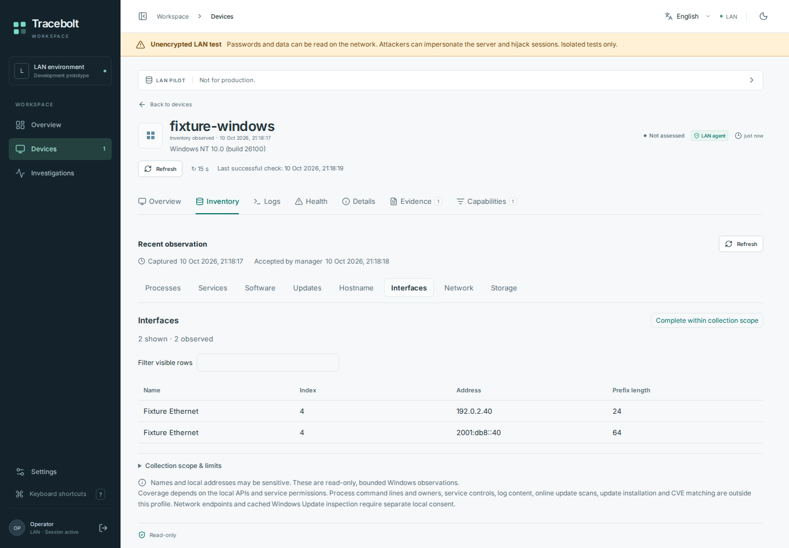
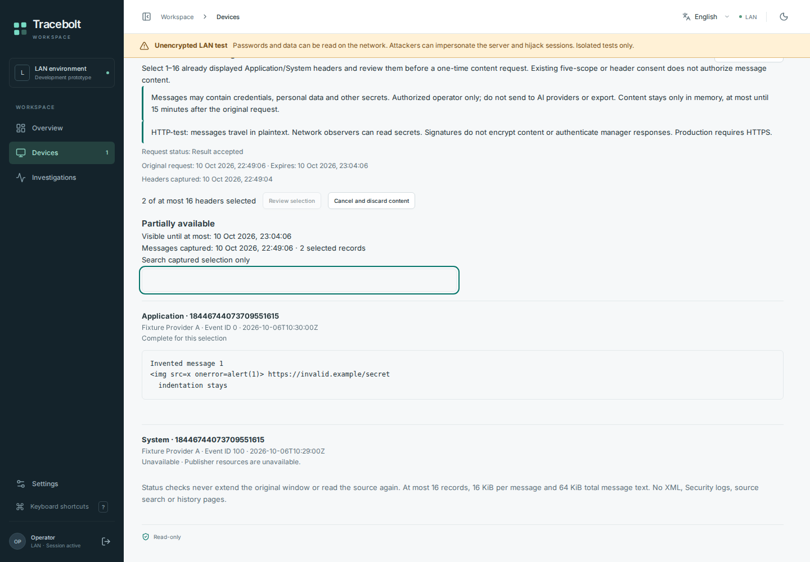
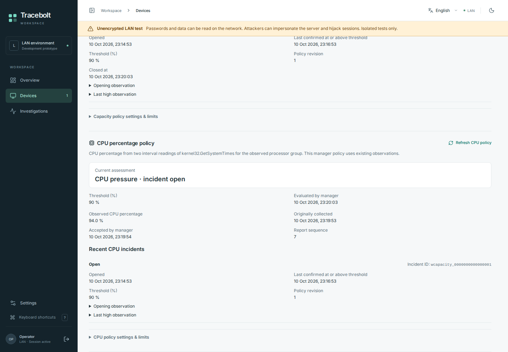

# Windows dashboard screenshots, 10 October 2026

The three original screenshots below are genuine browser captures of the compiled
Tracebolt UI with invented Windows data, copied unchanged from the successful
[hosted browser run, attempt 1](https://github.com/storminator89/Tracebolt/actions/runs/38086475900).
The capture source is
[`415d807143e28ade626b4e997842127d515f161e`](https://github.com/storminator89/Tracebolt/commit/415d807143e28ade626b4e997842127d515f161e),
whose Git tree is `578ac40bb84e287b0dfb8ff99683d9d05dc710e4`. That tree matches
reviewed head
[`1b8c16402ec463c97630d1e08eca8129b8c79e63`](https://github.com/storminator89/Tracebolt/commit/1b8c16402ec463c97630d1e08eca8129b8c79e63).
The captures establish rendering on this exact source, not later source changes.

All three PNGs were inspected at their original resolution and retain their
original bytes. No image was generated, retouched, cropped or assembled. The
names, addresses, update rows and measurements are synthetic fixtures. The
unencrypted HTTP-test warning stays visible. No user-host telemetry, credential,
invitation or provider response is shown.

These screenshots do not establish native Windows collection, endpoint consent,
an installed service, an online update scan, download, installation, reboot or
AI-provider use. The cached Updates view is an unreleased source preview. The
selected-event-message flow is absent from this original capture source; the
separate newer capture below records that source preview.

[Machine-readable provenance and SHA-256 hashes](provenance.json) preserve the
original filenames, source commit, fixture disclosures, viewports and
`publicSafe: true` manifest markings. Artifact `11682384530` has SHA-256
`9d7e1a19efbe6910194138dccfc17d084c924e2e72f7062eb2f1e375579d58a0`.
Both desktop images are 1440 × 1000; the mobile image is 390 × 844. These are
viewport captures, with no full-page stitching.

## Cached Windows Updates

The view shows invented cached update records, bounded paging, omitted-row
coverage and unknown cache freshness. It does not claim that a device is fully
patched or that the displayed rows are a current patch assessment. Refresh reads
the manager's accepted report; it does not start a scan or install updates.

## Windows inventory

The interface table contains the invented name `Fixture Ethernet` and
documentation-range IPv4/IPv6 addresses. The original capture time and collection
scope remain visible. The data comes from intercepted synthetic fixture replies.

## Mobile device overview, German

The compact German overview preserves the HTTP-test warning, original report
times and synthetic inventory counts. The device remains explicitly unassessed.

## Selected Windows event messages

This separate 1440 × 1000 English viewport capture is copied unchanged from
[Validate run 38091744846, attempt 1](https://github.com/storminator89/Tracebolt/actions/runs/38091744846).
The capture source is
[`9a1913066ab9811a6a69b4b039d7b416bce249a6`](https://github.com/storminator89/Tracebolt/commit/9a1913066ab9811a6a69b4b039d7b416bce249a6),
whose tree `12d3dfae06d256ff8f213f54ca7b5992d2a75dbe` matches reviewed head
[`103e1d7100e9517d4072c8dcf441dce75e8f1983`](https://github.com/storminator89/Tracebolt/commit/103e1d7100e9517d4072c8dcf441dce75e8f1983).
The manifest explicitly marks the image `publicSafe: true` and discloses invented
selected Windows messages rendered through the production UI with real
session/CSRF reads. This is UI-only evidence of unreleased source, with no native
event read, local grant, host change, AI call or external request.

The image was inspected at its original resolution. Its original bytes are
preserved, without generation, retouching, cropping or stitching. The invented
message includes literal HTML-like test text and a reserved example URL; neither
is real user data. The original expiry, selected-record limit, partially available
result, unavailable publisher resources and HTTP-test warning remain visible.
It does not establish native Windows acceptance or a complete device-health
assessment, and it is not a capture of the published Windows preview.

[Separate machine-readable provenance and SHA-256 hashes](selected-messages-provenance.json)
record the original filename, fixture disclosure, viewport, manifest and result
hashes. Artifact `11685055808` has SHA-256
`ae94e05d5ae7cb2be9af4ad0cc7a62703d3ae666e714ceb2f259f16dd6e9896c`.
The original three captures and their provenance above are unchanged.

## Windows health policy

This separate 1440 × 1000 English viewport capture shows the Windows CPU health
policy, an unreleased source candidate in
[PR #31](https://github.com/storminator89/Tracebolt/pull/31). That implementation is
tracked separately from this documentation change and is not part of the
published Windows preview. The image is copied unchanged from successful
[Validate run 38093714484, attempt 1](https://github.com/storminator89/Tracebolt/actions/runs/38093714484),
[browser job 114336736701](https://github.com/storminator89/Tracebolt/actions/runs/38093714484/job/114336736701).
Its capture source is
[`d8fae504f2d881dce016d1dc3b10c742b6997a09`](https://github.com/storminator89/Tracebolt/commit/d8fae504f2d881dce016d1dc3b10c742b6997a09),
whose tree `e5e4fc7289680abce96a60ecc63eb3000e09cab6` matches reviewed head
[`72bfa0dbe200a6c63d5deb1d46aaa3bb93b96ab6`](https://github.com/storminator89/Tracebolt/commit/72bfa0dbe200a6c63d5deb1d46aaa3bb93b96ab6).

The manifest marks this capture `publicSafe: true`. The compiled UI uses invented
policy, observation and incident replies with a real loopback fixture login.
The displayed 94% observation, 90% threshold and open incident are test data.
The original observation/acceptance times and the observed-processor-group CPU
scope remain visible; the value does not claim an all-processor-group aggregate.
The HTTP-test warning stays visible. This is not a complete device-health verdict.

The original PNG was inspected at its full resolution and remains byte-for-byte
unchanged, without generation, retouching, cropping or stitching. Enabled policies
are injected by read-only fixtures. No policy save, native Windows read, local
grant, installed-service acceptance, notification, AI call or deployment is
established by this image. No user-host telemetry or credentials are shown.

[Separate machine-readable provenance and SHA-256 hashes](health-policy-provenance.json)
record the original filename, disclosure, viewport, manifest and successful LAN
results. [Artifact `11685806804`](https://github.com/storminator89/Tracebolt/actions/runs/38093714484/artifacts/11685806804)
has SHA-256 `e09e59341386e9c44f81aa9241418ad6929e2a96341dcefd3cc70684d31aaeef`.
The original three captures, selected-message capture and their provenance are
unchanged. Successful capture-source checks do not rerun or validate runtime code
in this documentation-only change.

