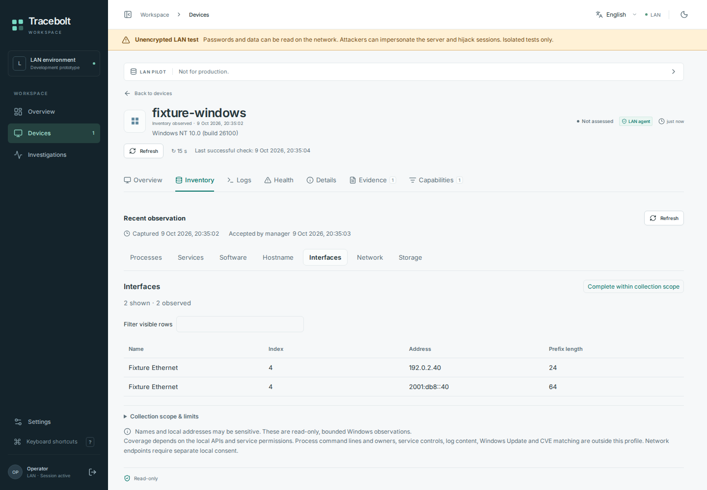

# Windows status and limitations

**Status checked: 11 October 2026. The unsigned x64
[v0.1.0-windows-preview.1 prerelease](https://github.com/storminator89/Tracebolt/releases/tag/v0.1.0-windows-preview.1)
is published.**

Its ten public files include the exact accepted Setup/service executables,
checksums, source/package manifests, finite native subset evidence and the
installation guide. The tested executable filenames retain
`v0.0.0-setup-candidate`; they were not rebuilt or renamed for publication.
This is a development prerelease, not a generally supported Windows release.
The Linux `v0.1.0-rc.3` release is not a Windows installer.

[Help index](README.md) · [Published preview guide](windows-prerelease-install.md) ·
[Parity roadmap](windows-linux-parity.md) · [Source Setup guide](windows-setup-preview.md)

## Implemented read scope

The fresh Setup coordinator requests one explicit local approval for these five
scopes. Hidden invitation entry and separate manager fingerprint/comparison
approval remain required.

| Scope | What is exposed |
| --- | --- |
| Base inventory | Bounded caller-visible machine/system metrics, hostname/adapters, processes, services and software registrations |
| Application/System event headers | Provider, event ID, level, timestamp, channel and record ID; no message content |
| Volume metadata | Caller-visible volumes and capacity, with unavailable/partial states |
| Process metrics | Per-process CPU and working-set RAM; CPU starts unknown until a usable second sample |
| Network endpoints | Numeric TCP/UDP addresses/ports and API-snapshot owning PID; no traffic payloads or DNS lookup |

The source fleet overview now displays and searches already-reported Windows
hostnames and IPv4/IPv6 interface addresses, with partial/unavailable states and
original capture age. See [Windows fleet display](windows-fleet-identity.md).
This manager/UI projection adds no local grant or collection.

Separately consented [adapter context](windows-adapter-context.md) now has a source
path for native link state, directional speeds and numeric DNS/gateway addresses
in the existing Network tab. It is not part of the five-scope setup or published
preview, and its native acceptance remains pending.

Separately consented [Defender and Windows Firewall posture](windows-security-posture.md)
now has a source path and private Security tab. It reports independent local
source states, including denial/unknowns and passive Defender, without asserting
overall protection or effective firewall policy. It is outside the five-scope
setup and published preview; native acceptance remains pending.

These scopes do not establish whole-machine coverage or Linux feature parity.
Configured service-startup metadata is a separate default-off source capability;
it is not included in the five-scope Setup choice. Windows event-message content,
Windows Update/CVE, remote service actions and external-AI export are not granted
by this setup.

*Actual shared-dashboard capture with invented fixtures. [Exact-source provenance](screenshots/2026-10-09-main-ui/README.md).
This image is not native collection or installation evidence.*

## Accepted packaged-Setup subset

[Run 38069058865, attempt 1](https://github.com/storminator89/Tracebolt/actions/runs/38069058865)
accepted exact source `14719116bdb663d13e4bcaef434a4374a6265fe6`, tree
`d2ec1451a0fb4332a48f0ee48b17c35eca807ad4`, on fresh hosted Windows Server 2025
x64 targets. All four packaged-GUI cases and the aggregate passed:

- TLS and explicit HTTP-test fresh installation, approval, automatic-start
  configuration, two accepted five-scope telemetry frames, reopen/cancel and
  owned-service removal with actual SCM absence observation.
- Cancellation during hidden invitation entry and while manager approval or
  transport was pending.

The published release uses the exact accepted bytes. The older failed run
37987458242 remains history and is not the accepted release gate. The
[release manifest](https://github.com/storminator89/Tracebolt/releases/tag/v0.1.0-windows-preview.1)
and [publication contract](windows-prerelease-publication.md) identify the
artifact/source/run bindings.

This proves only that hosted subset with a loopback fixture manager. It does not
certify Windows 10/11, interactive human UAC/SmartScreen behavior, real Linux
manager/shared-browser interoperability, shutdown/reboot persistence, upgrade,
full application/data removal, completed VM disposal or ARM64 runtime.
A later source revision does not inherit exact-artifact native acceptance.

## Newer source candidates

[Local own-agent restart](windows-own-service-restart.md) adds an explicit
receipt-bound `--restart --apply` source command for the fixed Tracebolt service.
It holds the existing installer lease, attempts stop/start once and observes SCM
with bounded polling. It does not add remote target-service control or
repair/upgrade. The published preview and its native acceptance do not cover it.

The separate [patch-context source candidate](windows-patch-context.md) adds fixed
Windows edition/release/build revision, bounded local WUA history and checked
reboot indicators to Updates. It is default-off, private and read-only. Retained
events never prove current installed status or patch compliance, and negative
indicators never prove that all reboot causes are absent. Native acceptance is pending.

The [cached Windows Update runtime candidate](windows-update-runtime.md) adds
separate local consent, a bounded isolated reader, v7 sender/manager support and
an operator-only Updates view. Cache freshness remains unknown; an empty cached
result does not establish that the machine is patched. No online scan,
download, installation, CVE mapping or reboot is provided. This code is not in
the published preview and still needs exact-source native/installed-service
acceptance.

[Selected event messages](windows-event-content-runtime.md) now have a separate
source path from stopped-service local consent through exact header selection,
consume-once isolated reading, authenticated transport and the shared Logs view.
The manager keeps message text only in an expiring, originating-admin-session
cache. A request selects at most 16 existing Application/System headers; output
is bounded to 16 KiB per message and 64 KiB total, with an immutable 15-minute
expiry. Missing records, denied reads, partial output and lost results remain
explicit. This is not retained-history browsing, content search or an AI export.

This path is also absent from the published preview. Synthetic transport/browser
fixtures and builds do not establish native Event Log reading under the installed
service or real Windows-to-Linux interoperability. See the
[manager boundary](windows-event-content-manager.md) and
[wire contract](windows-event-content-wire.md). Service actions, broader Health/AI,
complete process inventory and lifecycle improvements remain in the
[parity roadmap](windows-linux-parity.md). Existing grants are never widened by a
source or manager update.

## Complete inventory and fleet source slices

Separate default-off [complete Win32 service](windows-full-services-contract.md)
and [machine software registration](windows-full-software-contract.md) scopes are
implemented from local consent through bounded complete-generation transport to
protected search and paging. Software covers caller-visible HKLM 32/64 uninstall
registrations, retaining duplicates and unavailable optional fields. Complete
processes, per-user/MSIX/Store and portable-program discovery remain planned.

[Fleet hostname/IP display and search](windows-fleet-identity.md) is implemented
using existing Windows metadata in draft [PR #39](https://github.com/storminator89/Tracebolt/pull/39).
These are unreleased source slices; exact-source hosted CI and native acceptance
remain separate from the published preview and its five-scope receipts.

## Newer manager-only capacity policy

The source includes [opt-in Windows system-volume capacity checks](windows-capacity-health.md)
using already accepted caller-visible quota-aware disk metadata. Policy starts
disabled; explicit manager configuration does not grant a native read or widen
AI/notification access. This source change is separate from published preview
bytes and pending native/hosted-browser acceptance.

## Newer manager-only CPU and physical-RAM policies

The source also prepares independent default-off [CPU and physical-RAM checks](windows-resource-health.md)
using existing accepted basic metrics. CPU describes the observed processor group;
RAM describes physical memory not immediately available. These policies share the
capacity evidence engine and coordinated source read, with separate opt-ins,
revisions, history and durable floors. They do not add host collection or complete
Windows Health parity, and remain separate from preview/native/browser acceptance.

## Newer manager-only selected-service checks

The source adds independent default-off [service checks](windows-service-health.md)
with an EN/DE chooser for currently reported names and display names. Only unique
exact positive rows support state; missing/ambiguous rows always remain unknown.
Explicit should-be-running selections use 120-second stopped/paused confirmation
and 60-second running recovery. This manager policy changes no native collection,
SCM lifecycle, transport, local grant, AI or alarm scope. Native and hosted-browser
acceptance remain separate gates.

## Before trying the preview

Use an explicitly approved disposable Windows target, the reviewed exact Setup
and service hashes, and a compatible manager built from the same reviewed source.
For the published bytes, follow the [prerelease prerequisites and consent steps](windows-prerelease-install.md).
Keep HTTPS as the default and keep OS protection intact; unsigned builds may be
blocked by policy. Do not reinterpret a successful build as permission to install.

Cancellation after staging can retain protected identity and partial grants.
There is no general repair/reset, automatic upgrade or fresh-install resume.
**Uninstall service** retains application files and identity/state, and does not
revoke manager trust. Read [retained-state and removal behavior](windows-setup-preview.md#cancellation-retained-state-and-service-removal)
before acting; never delete state to force another installation.
