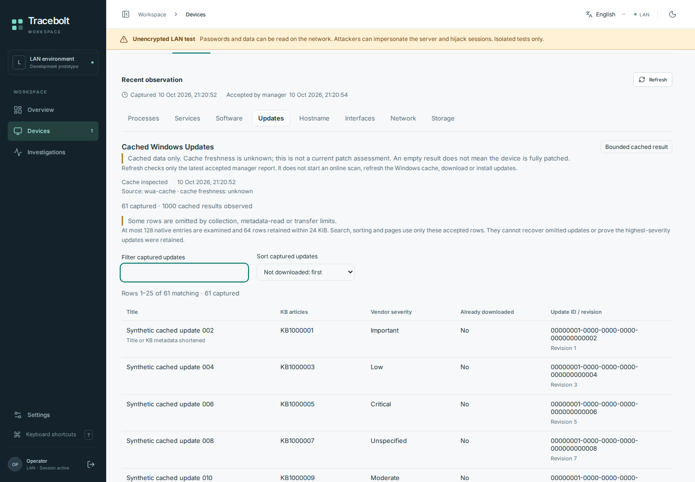

# Windows: current functionality and limits

The current development source targets a fresh x64 Read admin installation.
It is ahead of the published Windows preview and has not yet passed the current
profile's native installation/provider acceptance. Finish missing Admin data
before native acceptance and a new release.

[Guides](README.md) · [Fresh Read admin setup](windows-read-admin-setup.md) · [Next priorities](windows-admin-roadmap.md)

## Current development source

Fresh Setup offers **Read admin** with twenty explicitly disclosed read scopes,
grouped into concise sections. Consent starts unchecked, including the personal
session labels and identifying serial metadata. The manager and endpoint must
implement the same profile. Selecting it does not prove access under the
installed service identity.

| Area | Available source functionality | Important limit |
| --- | --- | --- |
| Fleet and resources | Reported hostname/IP search, CPU/RAM/volume observations, resource history | Original age and partial/unavailable sources remain visible; capacity is not disk health |
| CPU and memory context | [CPU models and source-labeled processor counts, installed SMBIOS RAM, OS-usable/available RAM, commit current/limit/remaining and aggregate pagefile capacity/use](windows-resource-context.md) | Independent sources; no pagefile names/paths, paging-I/O/thrashing/health verdict or change to CPU utilization sampling |
| Inventory | [Complete caller-visible process snapshots](windows-full-processes-contract.md), separate process CPU/working-set RAM sample, complete caller-visible Win32 services, HKLM 32/64 machine software generations | CPU/RAM remains a separately consented 128-row sample; no drivers, ACL-invisible services, per-user/Store or portable-app completeness |
| Software history | [Observed HKLM registration and metadata changes](windows-software-history.md) between complete comparable generations | Separate explicit seven-day history grant; whole-comparison quota gaps are visible. No actual install times or upgrade inference |
| Network | Numeric TCP/UDP endpoints, adapter link/DNS/gateway context, [caller-visible routes and raw interface octet/error/discard counters](windows-network-context.md) | Separate source snapshots without index joins; counters may reset, are not rates or guaranteed since-boot totals. No traffic capture, probes or DNS lookup |
| Updates | Build labels, bounded retained update history, checked reboot indicators | History is not current patch compliance; no online update scan or Windows CVE assessment |
| Security | Independent Defender/Firewall plus [Security Center antivirus registration/status and TPM presence/version](windows-security-coverage.md) | Client-only Security Center; no protection, TPM readiness or effective-policy verdict. BitLocker and Secure Boot remain open |
| Users / Sessions | Caller-visible WTS sessions and local domain/workgroup join context | No complete account discovery, session actions or remote desktop |
| Storage | Drive letters mapped to volume GUIDs, provider-reported physical-disk status/media/bus and separately consented [aggregate PerfDisk throughput, operations, latency and queue context](windows-storage-io.md) | Independent snapshots; no guessed topology, per-disk completeness, SMART or health verdict. Missing counters and idle latency remain unavailable |
| Hardware / power | Manufacturer/model, separately labeled chassis/BIOS serial, firmware and system battery/power | No validated unique hardware identity, RAM-module inventory or battery-health claim |
| Logs | Application/System event headers | Message content is a separate approval; no full retained-event browsing |

[Read admin scope contract](windows-read-admin-setup.md) links these fields to
their fixed local providers, exact grants and privacy notices. Disabled or denied
providers remain unknown/unavailable; Setup does not install providers or widen
service privileges to obtain data. Existing grant bytes keep their exact scope.

Current storage-I/O transport reserves a bounded 26 KiB base preview within the
unchanged frame ceiling. Complete inventory and derived history use their separate
bounded transport/store. See [frame bounds](windows-storage-io.md#worker-transport-and-privacy).

## Separate optional features

- [Selected event messages](windows-event-content-runtime.md): request exact
  reported headers under a separate local grant. Message text expires in the
  originating operator session's private cache; it is not retained-history or AI export.
- [Cached Windows Update inspection](windows-update-runtime.md): an independently
  granted offline cache read. Freshness stays unknown; no scan, download,
  installation or reboot is performed.
- [Disk](windows-capacity-health.md), [CPU/RAM](windows-resource-health.md) and
  [selected-service checks](windows-service-health.md): independent default-off
  manager policies over already accepted observations. Missing data stays unknown.
- [Selected service control](windows-service-actions.md): a separately authorized
  source workflow with a restricted broker and exact reviewed target. Read admin
  does not install the broker or grant service actions. Native acceptance is pending.

*Actual source-preview capture using invented data. [Capture details](screenshots/2026-10-10-windows-parity/README.md).
This does not show native Windows collection or the published preview's features.*

## Published preview

The unsigned x64
[v0.1.0-windows-preview.1](https://github.com/storminator89/Tracebolt/releases/tag/v0.1.0-windows-preview.1)
contains the older **five-scope** setup: base inventory, Application/System event
headers, volume metadata, process metrics and numeric network endpoints.
It does not contain the current twenty-scope Read admin profile or later
complete inventory, context, message-content and cached-update additions.

Its accepted native subset covers fresh hosted **Windows Server 2025 x64** with a
loopback fixture manager: installation, approval/reporting, cancellation and
owned-service removal. This result does not transfer to later source or prove
Windows 10/11, real Linux-manager/shared-browser interoperability or reboot.
Exact artifact/source evidence is in the [published installation guide](windows-prerelease-install.md#selected-native-evidence).

## Before installing or releasing

Current-source Windows 11/provider/service-identity acceptance, real manager
interoperability and reboot/sleep behavior remain open. Signing, ARM64 runtime
and deliberate complete removal are separate work. See the
[desktop acceptance checklist](windows11-acceptance-matrix.md).
There are no existing user installations to migrate; upgrades and reconsent are
preserved development interfaces, not current delivery gates.

Use reviewed matching artifacts on an explicitly approved target. Keep HTTPS
and OS protections intact. An unsigned build may be blocked by policy.
Cancellation can retain identity and partial state; service removal retains
files and does not revoke manager trust. Follow the
[retained-state/removal guide](windows-setup-preview.md#cancellation-retained-state-and-service-removal)
instead of deleting state to retry setup. Builds, CI and screenshots do not
by themselves authorize host changes or establish native acceptance.
